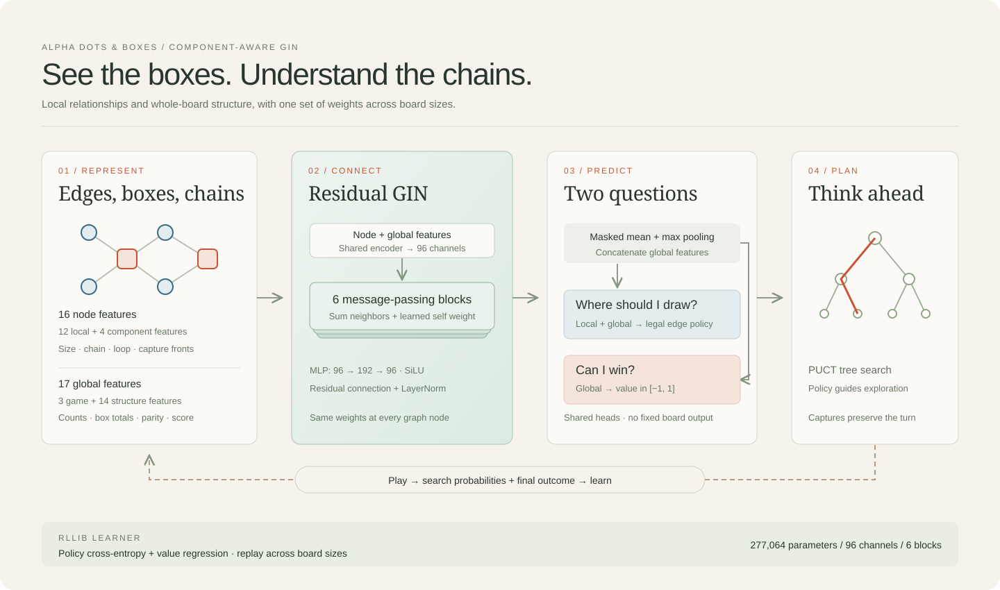

# Component-aware GIN refinement

## Why change the encoding

The retained six-block GIN gives effectively the same value to two reachable
14×14 positions with opposite exact outcomes. The changes lie in central loops,
away from border information available to its local message passing. Full
prefixes and values are in the
[representation diagnostic](data/large-search-20261012/representation-diagnostic.json).
This example identifies missing information; it is separate from 10×10 matches.

The new optional encoding adds four box-node features: component size in
four-box units, closed-chain status, closed-loop status, and capture fronts.
Fourteen global features describe chain/loop box totals and counts, three-box
chains, four/six-box loops, short chains, active/branching components, parity,
current score margin and remaining boxes. Counts use fixed box units across
board sizes. The graph still uses shared edge/box weights and no coordinates.

Legacy checkpoints use 12 node features and three context features. Structured
checkpoints use 16 and 17 respectively. Both retain width 96 and six residual
GIN blocks. Parameter counts are 272,648 and 277,064. The initializer copies
existing weights into their corresponding columns and zeros new columns;
prediction-preservation tests cover 1×1 through 14×14 and NumPy export.

## Training experiment

Two runs use RLlib's LearnerGroup and the same backbone, initial predictions,
seed 75, board curriculum, sampling/search settings and update budgets:

- `component-large.json` enables component features and starts from expanded
  retained weights. Initial checkpoint SHA-256:
  `5c7bed891c467ffcb86bcbe5a046b3097b617b914b9e062520be323ca23ec0b2`.
- `data-large.json` retains the original encoding and starts from `larger.pt`.
  This control tests whether larger-board data alone accounts for improvement.

Each run has an eight-hour maximum, three CUDA samplers with 16 games per batch,
48 games per iteration, 256 new simulations per nonexact move, tree reuse and
the exact structural oracle. Board sizes are 4×4, 5×5, 8×8, 10×10 (twice in the
sampling list) and 12×12. A quarter of starts are legally generated chain/loop
endgames; another optional archive draw uses 10% of the remaining starts.
Every endgame start is reached by legal play, including current scores.
Neither run uses the experimental root-shortlist mode.

Updates use batches of up to 2,048 positions, 16 updates per iteration, learning
rate 0.0001 and replay capacity 300,000. The matching configuration and seed
control budgets; trajectories can diverge after learning. Logs record policy
loss, value loss, value MAE, entropy/KL, starts, sampling/update time and GPU
peak allocation. Checkpoints are saved every five iterations.

## Shared resources and inference

Each learner has a 24 GiB allocator limit. Each CUDA sampler retains its
existing 1 GiB limit. Two learners plus six samplers therefore have aggregate
allocator ceilings of 54 GiB. Before launch, the H200 reported 72,895 MiB free;
the other GPU workload remains running. Training uses low CPU scheduling
priority and private Ray session directories. Only owned clusters/processes
are managed.

A single RLlib update with 2,048 12×12 positions used 19,514.6 MiB peak allocation
and 20,514 MiB reserved, completing in 1.183 seconds. This probe is a memory and
correctness check, not a throughput or strength benchmark.
[Probe receipt](data/large-model-20261012/gpu-probe.json).

CUDA self-play keeps padded adjacency matrices on device and changes them only
when a batch slot changes board shape. Ordinary deployment still requires NumPy;
PyTorch, Ray/RLlib and CUDA remain training dependencies.

## Selection protocol

Checkpoint screens use 12 paired-seat 10×10 games at 512 simulations against the
released constant-0.33 NumPy search, on disjoint opening ranges starting at
10001 and increasing by 1000 per screening treatment. No oracle, proof, reuse,
noise or timer is enabled in these matches: the comparison changes the learned
model and its encoding. Screen results only select a candidate.

Before confirmation, freeze the checkpoint and settings. A fresh 40-game match
at 1,024 simulations against released search must score above 50%, with the
lower 2.5th percentile of the 20,000-resample paired-opening bootstrap (seed
4199) above 50%. Confirmation ranges start at 200001, with a 1000-seed increment
for a new attempt. A separate 20-game control against the older zero-first-play
search uses ranges starting at 300001 and requires at least 50% score. Full
replays and actual work are checked. An optimistic completion may reject a
mathematically futile run; stopped receipts must identify planned and retained
counts. Smaller-board behavior and actual web settings are checked before
deployment. No larger-board improvement is claimed at launch.

The first launches stopped before their first update: reuse attempted to promote
a value-only solved leaf with no action list. Search now rebuilds such nodes as
fresh roots when the root oracle cannot finish an action solve. A regression
test reproduces the timed-out root solve. Settings are unchanged; restarted runs
use `runs/large-model-20261012/component-v2` and `data-control-v2`.

## First completed iteration

Both runs completed 48 games and 7,095 positions, with 32,768 sample
presentations. Structured value loss was 0.5888 and value MAE 0.6042;
control values were 0.5999 and 0.6165. Sampling took 842.77 and 802.46 seconds,
updates 20.33 and 16.02 seconds, and own learner peaks were 19,516.8 and
19,337.6 MiB. These losses are training observations, not evidence of stronger
play. [Full progress records](data/large-model-20261012/training-progress.json).

The frozen structured NumPy snapshot has SHA-256
`7b82732a17fa2b7fac526ed49ac34ff89ba96392ee753c50b1f6ec477b27962d`;
control snapshot SHA-256 is
`9419146ed63e7dd7a4af8029ef16f29df1347956b628bef7758eabea748f0c7c`.
On the diagnostic win/loss pair, structured predictions differ by 0.01872;
the control still differs by only one float32 step. Both structured predictions
are still negative, so the winning fixture remains misclassified. The encoding
now carries distinguishing information, but more learning is needed.
[Structured diagnostic](data/large-model-20261012/component-00001-representation.json),
[control diagnostic](data/large-model-20261012/data-control-00001-representation.json).

## First model screen and frozen confirmation

The first structured screen (seed 10001) finished **9 wins, 1 draw and 2 losses**
on 10×10: 79.17% score, paired bootstrap interval 62.5–95.83%, and mean margin
+20.33 boxes. Both sides completed 512 simulations on every nonexact decision;
there were no oracle solves, proof propagation, inherited visits or deadlines.
Full legal replays were validated. This is a selection screen, not a fresh
confirmation. [Raw games](data/large-model-20261012/component-00001-screen.json),
[validated summary](data/large-model-20261012/screen-summary.json).

The same iteration-one checkpoint is frozen for 40 fresh games at 1,024
simulations, seed 200001, against released constant-0.33 search. A separate
20-game control uses seed 300001 against zero-first-play search. The settings
and gates were saved before either match started in the
[confirmation plan](data/large-model-20261012/component-00001-confirmation-plan.json).
Training continues independently; no serving weights have been replaced.

**Confirmation rejected.** After 36 complete games the frozen iteration-one
model finished 15 wins and 21 losses: 41.67% score, paired interval 25–58.33%,
mean margin −2.50 boxes. Even four further wins would yield only 47.5%, so the
planned 40-game match stopped for mathematical futility. The dependent old-search
control stopped at eight paired games, four wins and four losses; it is incomplete
and does not establish a control result. Every retained nonexact decision
completed 1,024 simulations. Interrupted games are excluded from paired results.
[Validated screen and stopped-match summaries](data/large-model-20261012/component-00001-summary.json).
Stopped receipts reconstruct invocation settings and historical source hashes
from revision `74cc6c2`, preserving complete pairs from append-only progress.
The next isolated arm is [exact component-value teaching](component-teaching.md).

The frozen learned weights also passed a Torch-versus-NumPy comparison on 101
legal positions across seven board shapes, from 1×2 through 14×14, with seven
padding nodes. Maximum logit and value differences were 0.00000572 and
0.000000358. The logit comparison uses absolute tolerance 0.000003 and relative
tolerance 0.00003. This checks numerical export, not playing strength.
[Parity receipt](data/large-model-20261012/component-00001-parity.json).
The export regression now tests both encodings with nonzero component weights;
all 22 targeted export, growth and learner tests passed.

After two iterations each run has completed 96 games. Structured replay contains
14,965 positions, control replay 13,397. Value loss is 0.5965 versus 0.5992;
value MAE is 0.6080 versus 0.6101. Sampling took 967.71 and 745.95 seconds in the
second iteration. Trajectories now differ, so sampling times are observations
of these runs rather than a matched speed comparison.

## GPU arithmetic probe

An isolated CUDA-graph probe compared IEEE float32 and TF32 matrix operations
with batch size 16, padded capacity 456, the structured iteration-two weights,
and legal random positions on 10×10 and 12×12. Each mode was measured twice
in alternating order, with five groups of 40 predictions per measurement.
Shared-GPU timings varied substantially. Median batch times were 9.674 ms
for IEEE and 9.600 ms for TF32; this does not establish a useful speed gain.
Maximum policy and value differences were 0.000111 and 0.000091, with no
argmax changes on the 16 probe positions. Active training precision remains
unchanged. The probe's peak allocation was 65.8 MiB.
[Probe measurements](data/large-model-20261012/tf32-probe.json).

## Optional compiled feature encoding

Profiling identified component traversal as a substantial part of Python
encoding work. The optional `_components` kernel uses typed traversal buffers
and emits the same node/context arrays. Complete-game and player-perspective
comparisons cover eight board shapes through 12×12, including constructed
chain/loop starts. All 16 targeted acceleration, encoding and CUDA tests passed.

An alternating Python/compiled probe with batch 16 and capacity 456 measured
median feature time of 182.8 versus 40.9 microseconds per state, about 4.5× faster.
Median end-to-end CUDA batch times were 9.482 versus 7.777 ms, an 18.0% reduction
under shared load. Predictions were identical on every probe input. This is an
encoding/inference measurement, not an observed self-play or strength gain.
[Probe receipt](data/large-model-20261012/compiled-component-probe.json).

Build all optional kernels with `python scripts/build_acceleration.py` after
installing the acceleration extra. Ordinary deployment needs no compiler.
`ALPHABOXES_PURE_NUMPY=1` disables this kernel as well as the optional search and
endgame kernels. Existing sampling actors retain their imported implementation
until a controlled restart; the matches in this campaign use Python/NumPy.
