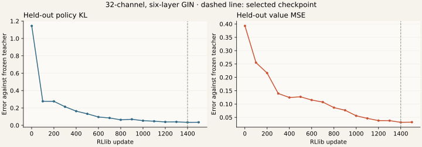

# A smaller evaluator for timed alpha–beta

A narrower GIN evaluates positions about 2–2.8 times faster with NumPy on the
tested boards, but scored below 50% against the full-size alpha–beta agent on
both boards. Matches against deployed MCTS are still running. The released
model and default MCTS agent on port 9003 remain unchanged.

## Controlled change

The [previous Deep comparison](engine-deep-benchmark.md) found that basic
alpha–beta lost to the retained MCTS agent. This experiment asks whether cheaper
evaluation gives alpha–beta enough extra search to improve its play.

The student retains six GIN layers, the graph representation, residual blocks,
pooling and policy/value heads. Width changes from 96 to 32 channels, reducing
parameters from 272,648 to 31,496. Search, move ordering, deadlines and the
12-edge exact root aid stay unchanged. This tests width compression; it does not
add incremental evaluation or chain extensions.

The [plan](data/evaluator-distillation-20261011/plan.json) was recorded before
training and matches. Teacher weights are the retained `models/larger.npz`:
`21d8df7a60ba770e45a35d8405e009417904e250813fb3134403fb7707ae87b0`.
The preselected student has SHA-256:
`730c2ba93c94d6de5ca7388b063313d2139169729b753fd13b3959ea946f2206`.

## Training and validation

RLlib trained a randomly initialized student for 1,500 updates, using batch size
1,024, learning rate 0.0003 and seed 3601. Targets are frozen teacher **network**
policy and value predictions, rather than search estimates. Existing exact
labels in the corpus are ignored in this arm.

The 6,856-position corpus contains 2,422 positions from 4×4 and 4,434 from 5×5.
A board-stratified split holds out 685 positions and trains on 6,171. This is an
imitation check: nearby positions can come from the same source game, so it is
not independent evidence of game strength.

Validation runs every 100 updates, plus the first and last updates. Selection
minimizes held-out policy KL plus value MSE, without using match outcomes.
Update 1,400 was selected:

| Metric | After first update | Selected update |
| --- | ---: | ---: |
| Policy KL against teacher | 1.14460 | 0.03418 |
| Value mean-squared error against teacher | 0.39289 | 0.03140 |
| Value mean absolute error against teacher | 0.50579 | 0.10394 |
| Agreement with teacher's top move | 3.36% | 65.11% |



The measured training loop and export took 446.7 seconds, excluding corpus
encoding and Ray startup. Peak allocated GPU tensor memory was 661.8 MiB, under
an 8 GiB cap and a 50% update duty cycle. The owned local Ray instance shut down
after training; other GPU jobs continued running.

## Inference cost

One BLAS/OMP/MKL thread evaluates the same legal positions with each network.
Each measurement includes graph encoding, the NumPy network and policy
normalization. Prediction caches are cleared before every call; five warmups
are excluded, followed by 200 timed repetitions. Measurements ran alongside
the eight-worker match process on the shared machine.

| Opening board | Teacher median | Student median | Speedup |
| --- | ---: | ---: | ---: |
| 4×4 | 1.374 ms | 0.683 ms | 2.01× |
| 5×5 | 1.859 ms | 0.817 ms | 2.28× |
| 10×10 | 6.160 ms | 2.273 ms | 2.71× |

The opening, middle and later-position measurements span 2.01–2.84× speedup.
Fewer parameters do not translate directly into proportional speed: graph
encoding, aggregation and other work still have costs. These are evaluation
latencies, not complete-move or 10×10 strength measurements.

NumPy/PyTorch parity passed on 64 positions, including rectangular boards and
10×10 openings and middlegames. Maximum absolute errors were 0.000001073 for
policy probabilities and 0.000001937 for values. Matches use the ordinary
deployment environment with no PyTorch, Ray, Gymnasium or Cython extensions.

## Playing-strength protocol

Both arms use the same frozen student, with two seconds per move and twenty
games per board. Ten six-edge random openings are played with seats swapped.
The first arm compares student alpha–beta with teacher alpha–beta, isolating
the evaluator change. The second compares it with teacher MCTS, the released
agent. Seeds are 3602 and 3603 respectively; no result selects another student.

Eight CPU workers each use one BLAS thread. Both players receive independent
prediction caches, cleared per game, and a fresh planner per move. Alpha–beta
retains its depth ceiling of 64; MCTS retains its 8,192-traversal ceiling. Timed
cutoffs depend on shared machine load. Benchmark ties choose the lowest-index
maximum, while the web service randomizes tied maxima.

Ten opening pairs per board are exploratory evidence, not a release gate or an
expert-human strength claim.

## Control results: student versus teacher alpha–beta

All forty games completed and passed legal-history, seat-pairing and score
replay checks. Scores and margins are from the student's perspective; a draw
contributes half a point.

| Board | Games | Student wins / draws / losses | Student score | Mean box margin |
| --- | ---: | ---: | ---: | ---: |
| 4×4 | 20 | 7 / 1 / 12 | 37.5% | −1.9 |
| 5×5 | 20 | 7 / 0 / 13 | 35% | −1.6 |

Moves with more than twelve free edges, excluding the exact root solver:

| Board | Median nodes, student / teacher | Median completed depth, student / teacher |
| --- | ---: | ---: |
| 4×4 | 6,463 / 3,354 | 4 / 4 |
| 5×5 | 5,259.5 / 2,398.5 | 3 / 3 |

The student searches more nodes within the deadline, but does not improve the
median completed depth or match score in this sample. Players visit different
positions, so these counters describe their games rather than a common-position
depth comparison. The result does not establish whether imitation error, move
ordering or another factor dominates the strength loss.

The second, forty-game arm against deployed MCTS is in progress. The same
selected student is used regardless of the control results.

## Receipts and reproduction

The [frozen targets](data/evaluator-distillation-20261011/frozen-targets.npz),
[training configuration and split](data/evaluator-distillation-20261011/config.json),
[per-update metrics](data/evaluator-distillation-20261011/metrics.csv),
[validation measurements](data/evaluator-distillation-20261011/validation.json),
[checkpoint selection](data/evaluator-distillation-20261011/selection.json),
[export parity](data/evaluator-distillation-20261011/parity.json) and
[complete latency samples](data/evaluator-distillation-20261011/latency.json)
preserve the numerical results. The [student NumPy weights](data/evaluator-distillation-20261011/student.npz)
are retained for reproduction and are not the recommended deployment checkpoint.
The [control game histories](data/evaluator-distillation-20261011/alpha-matches.json)
and [validated match summary](data/evaluator-distillation-20261011/summary.json)
include weights, code hashes, runtime settings and search counters.

Training requires the `train` extra. Match and latency commands require ordinary
deployment dependencies only. For the recorded match backends, use an
installation without the optional Cython extensions.

```bash
OPENBLAS_NUM_THREADS=1 OMP_NUM_THREADS=1 MKL_NUM_THREADS=1 \
  python scripts/distill.py \
  --dataset docs/data/evaluator-distillation-20261011/frozen-targets.npz \
  --output runs/distilled-student

OPENBLAS_NUM_THREADS=1 OMP_NUM_THREADS=1 MKL_NUM_THREADS=1 \
  python scripts/benchmark_evaluator.py \
  --checkpoints models/larger.npz docs/data/evaluator-distillation-20261011/student.npz \
  --output runs/distilled-latency.json

OPENBLAS_NUM_THREADS=1 OMP_NUM_THREADS=1 MKL_NUM_THREADS=1 \
  python scripts/benchmark_engine.py \
  --checkpoint docs/data/evaluator-distillation-20261011/student.npz \
  --reference-checkpoint models/larger.npz --reference-engine alpha_beta \
  --skip-latency --match-seconds 2 --games 20 --seed 3602 --workers 8 \
  --output runs/distilled-alpha-matches.json

# Second arm: use --reference-engine mcts and --seed 3603.

python scripts/summarize_engine.py --receipts runs/distilled-alpha-matches.json \
  --output runs/distilled-match-summary.json
```

The full suite passed 106 tests. The later replay-summary checks also passed,
including rejection of corrupted scores and comparison of separate checkpoints
with the same search algorithm.
