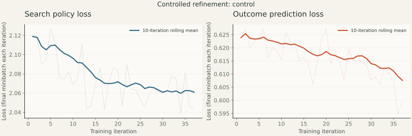

# Controlled training refinement

Updated 2026-10-11 08:28 UTC.

All arms start from the same released 96-channel, six-layer checkpoint.
Search uses 512 simulations and a root-only 12-edge solver. Batch size is
8,192. The control uses 16 updates; the ratio arm uses four; the midgame
arm adds 50% archive starts to that four-update setting. Other settings match.
Each arm is bounded to 64 rounds or two hours, saving completed rounds.

| Arm | Rounds | New games | New positions | Hours | Last policy / value loss |
| --- | --- | --- | --- | --- | --- |
| control | 37 | 4,736 | 210,842 | 2.049 | 2.043 / 0.599 |

Losses describe the final replay minibatch in each round. Entropy, policy
mismatch, midgame starts and sample presentations are available in raw metrics.
They do not establish strength. Compare equal-round snapshots across arms.

**Deployment:** Released model retained.

[Raw settings and receipts](data/refinement-training-20261011/) retain model
hashes and complete game histories. Deployment inference uses NumPy only.
